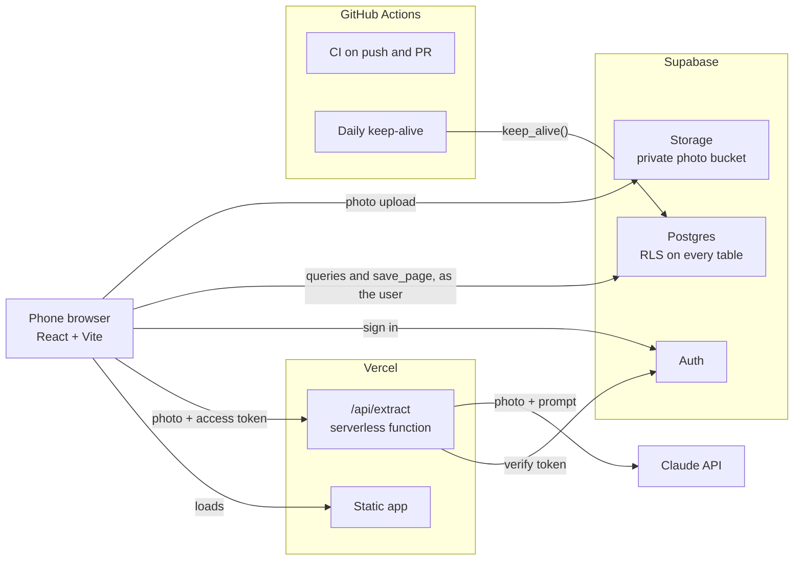

# reprise

A phone app that turns photos of highlighted book pages into a spaced-repetition review queue.

**Live:** https://reprise-five-kappa.vercel.app

Signups are closed. reprise is a single-user app, so the live site is a sign-in screen for its owner. The code, the decisions behind it, and the accuracy method are all in this repository.

<!--
TODO: add 2-3 phone screenshots to docs/screenshots/ and uncomment.

| Capture review | Daily review | Browse |
| --- | --- | --- |
|  |  |  |
-->

## What it does

**Capture.** Pick a book, or add one by title and mark it nonfiction or biography. Type the page number, then take or choose a photo of the page. The browser shrinks the photo to at most 1568 px on the long edge and sends it to a server function, which asks Claude to read the highlights, their colors, and the pen codes and symbols written beside them. The reply is checked against a schema before the app sees it.

**Review.** The extracted highlights come back as compact cards, one open at a time. I can fix the text, switch the color, toggle codes and symbols, delete a highlight, or add one the model missed. Retake and Discard sit above a sticky Save bar.

**Save.** Saving uploads the photo to a private Storage bucket, then writes the page and all its highlights in one database transaction. The model's original reply is stored with the page, next to the highlights as I corrected them. New highlights are first due the next day.

**Daily review.** Each day shows up to 10 due highlights, oldest due date first, one card at a time. Two buttons: Know it moves a highlight up one Leitner box (1, 3, 7, 14, then 30 days); Again sends it back to box 1, due tomorrow. Each grade is saved before the next card appears, so leaving halfway keeps the progress. A new card draws its highlight behind the quote with a short highlighter sweep, which turns off under `prefers-reduced-motion`.

**Browse.** Every saved highlight, newest page first, 50 at a time. Filter by book, color, and code; the filters run in the database.

## How I annotate

The app is built around a fixed annotation system, so extraction is a classification problem with a closed vocabulary rather than open-ended reading.

Two highlighter colors. What each means depends on the kind of book, and the app always shows the label next to the color:

| Color  | In nonfiction | In a biography |
| ------ | ------------- | -------------- |
| Pink   | Claim         | Their words    |
| Yellow | Evidence      | Turning point  |

Ten pen codes in the margin, each belonging to exactly one highlight: `H`, `A`, `C`, `RCT`, `Obs`, `Meta`, `n=`, `M`, `anec`, `L`.

TODO: add a one-line meaning for each code. The repository defines the codes but not what they stand for.

Five pen symbols: ✓ try, ? doubt, ! surprise, ✗ disagree, → connects.

Anything else on the page is ignored. The vocabulary lives in one file, `shared/vocabulary.ts`. The Zod schemas and the UI import it, and a test checks that the database's check constraints match it.

## Architecture



The browser is a React single-page app. It talks to Supabase directly with the signed-in user's session, so Row Level Security decides what each request can see or change. The one thing the browser cannot do is call Claude: that happens in `api/extract.ts`, a Vercel function that checks the caller's Supabase token, validates the image, runs the extraction, and returns parsed highlights. The function never touches the database. A scheduled workflow pings the free-tier Supabase project once a day so it is not paused for inactivity, and CI checks every push.

## Key engineering decisions

The full table, with the alternative considered and when to revisit each, is in [DECISIONS.md](DECISIONS.md).

- **The API key stays on the server, and the endpoint checks auth first.** `ANTHROPIC_API_KEY` is read only in `api/extract.ts`, and a lint rule stops browser code from importing `server/`. The function verifies the bearer token with Supabase before it reads the request body, so a stranger can't spend the key.
- **No server-side database access.** The browser writes with the user's own session; there is no service-role key in the code. Tables have explicit grants (signed-in users only; the anonymous role gets nothing) instead of Supabase's default exposure.
- **Ownership is enforced by the schema, not just by policies.** Every table has RLS, and child rows point at their parent with composite foreign keys on `(id, user_id)`. A page cannot be attached to someone else's book even by a role that bypasses RLS.
- **Saving a page is atomic.** A `save_page` database function inserts the page and all of its highlights in one transaction. It runs as `security invoker`, so the same grants and policies apply as for direct inserts. If the database rejects the save, the app removes the uploaded photo (best effort).
- **A request time budget with the arithmetic written down and tested.** Auth is capped at 10 s and each Claude call at 130 s, with at most two attempts, for a worst case of 270 s, under Vercel's 300 s limit. The phone gets a JSON error instead of a platform timeout. SDK retries are off because the SDK sleeps for as long as `retry-after` says, which would make the worst case unbounded.
- **Deterministic fixes live in tested code, not the prompt.** Line-break hyphens are joined by a small normalizer after parsing. The prompt asks for it too, but during the kill test the model reported joining hyphens that it had not joined. Replies are parsed as text and validated with Zod; if one fails, the model is shown its own bad reply and the error and gets one retry.
- **The eval is built from human-corrected output.** Every saved page keeps the model's raw reply next to the highlights I corrected, so accuracy can be measured later without new model calls or a separate labeling pass. The script signs in with the publishable key, so RLS applies, and its output contains counts only, never book text.

## Measuring the AI

### Kill test

Before building the app around the model, I ran a go/no-go test on 5 real annotated pages (1 biography, 4 nonfiction), photographed in direct sun with hard shadows, a sticky note, and facing pages in frame. The pass rules were fixed in advance: at most 1 color mistake, at most 2 code mistakes, no missing or extra sentences. Model: `claude-sonnet-5-5`.

| Prompt version                        | Colors | Codes |
| ------------------------------------- | ------ | ----- |
| v1                                    | 26/26  | 7/7   |
| v2 (hyphen normalizer, pen-mark rule) | 24/24  | 7/7   |
| v3 (gap rule)                         | 27/27  | 7/7   |

Declared a pass, and the prompt was frozen at v3. The remaining issues at v3 were one highlight cut at a line break and one typo. Full per-version notes and lessons are in [eval/KILL_TEST.md](eval/KILL_TEST.md). Those five pages are the dev set and are excluded from the reported accuracy.

### Accuracy

TODO: paste the results of `npm run eval` here (date, prompt version, number of pages, and per-field figures). The script writes them to `eval/RESULTS.md`, which is not committed.

**Method.** The eval set is 15 pages of one biography that were not used while tuning the prompt. For each saved page, `npm run eval` compares what the model returned (`pages.raw_extraction`) with the highlights as I corrected them in the review screen, which count as ground truth. Highlights are paired one-to-one by text similarity (at least 0.6 on a normalized edit-distance measure, best pairs first). It then reports:

- detection: precision, recall, and F1 for finding highlights;
- color accuracy, exact-text rate, and mean text similarity, over matched highlights;
- precision, recall, and F1 for codes and symbols, over matched highlights.

**Limits.**

- One book, and a biography. The results say little about nonfiction pages, where the pink and yellow roles and the codes differ.
- Anchoring bias. The ground truth is the model's output after I edited it. A mistake I didn't notice during review counts as correct, so every figure is an upper bound on true accuracy, not an estimate of it.
- Small sample, and results vary from run to run (the kill test showed this), so small differences between prompt versions are noise.
- The match threshold is a judgment call. It is documented in `scripts/eval/metrics.ts`, and very short highlights can be paired wrongly.

## Testing and CI

There are 324 tests in 26 files, run with Vitest. They cover:

- the Leitner scheduler, including date handling in the phone's time zone;
- the extraction parser and hyphen normalizer;
- the `/api/extract` handler: auth, image type and size checks, error mapping, and the time-budget arithmetic;
- save, review, browse-filter, and error-message logic, written as pure functions;
- the eval scoring;
- WCAG 4.5:1 contrast for the text and background color pairs in the design tokens;
- a check that the database's allowed colors, codes, and symbols match `shared/vocabulary.ts`.

What is not covered: no test talks to a live database, so RLS and the foreign keys are not exercised in CI, and there are no component or end-to-end tests.

CI (`.github/workflows/ci.yml`) runs on every push and pull request with placeholder environment values and no secrets: `npm ci`, `npm run build` (type check plus Vite build), `npm test`, `npm run lint` (oxlint), `npm run format:check` (Prettier), and `npm audit --audit-level=high`.

`main` is protected by a repository ruleset: changes go through a pull request, the `check` job must pass, and force-pushes and branch deletion are blocked. It requires zero approving reviews, since there is one contributor.

## Run it locally

You need Node 22 (see `.nvmrc`), the [Supabase CLI](https://supabase.com/docs/guides/local-development/cli/getting-started), your own Supabase project, and an Anthropic API key.

```bash
git clone https://github.com/ng8nestor/reprise.git
cd reprise
npm install
cp .env.example .env
```

Fill in `.env`: `ANTHROPIC_API_KEY`, `VITE_SUPABASE_URL`, and `VITE_SUPABASE_PUBLISHABLE_KEY`. The `EVAL_*` values are only for `npm run eval`.

```bash
supabase link --project-ref <your-project-ref>
supabase db push
npm run dev
```

The app has no sign-up screen, so create your user in the Supabase dashboard under Authentication, then sign in with it.

`npm run dev` starts Vite only, which does not serve `/api/extract`. Everything except photo extraction works with it. `/api/extract` needs Vercel's runtime, so capture has two options. A Vercel preview deploy works. Running it locally with the Vercel CLI (`vercel dev`) should also work, but I have not tested it.

Other scripts: `npm test`, `npm run lint`, `npm run format:check`, `npm run extract` (run extraction over images in `eval/pages/`, macOS only), and `npm run eval`.

## Scope and roadmap

[SCOPE.md](SCOPE.md) is the contract for v0.1, and anything outside it goes to [PARKING_LOT.md](PARKING_LOT.md) instead of into code.

**In v0.1:** single-user email login with RLS on every table; photo capture with extraction, editing, and atomic save; daily review on a Leitner schedule; browsing with book, color, and code filters; unit tests and CI; an accuracy eval.

**Cut:**

- **Text search box.** It was first in the cut order. Browsing by book, color, and code covers narrowing down highlights, and capture, storage, and review were never to be cut.
- **Sentry.** It was second in the cut order and was never integrated. The extraction function logs its failures, and the app shows loading, error, and empty states.

**v0.2:**

- Handwritten margin notes, beyond the fixed codes.
- A custom vocabulary per user, so another reader can use their own colors and codes.

Other deferred items, such as semantic search, linking highlights with →, and page-number extraction, are listed in SCOPE.md.
